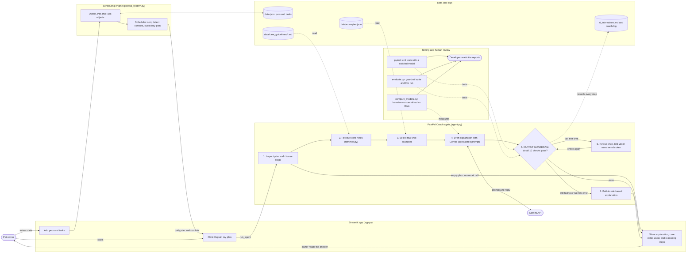

# PawPal+ AI Coach

An applied AI system that explains a busy pet owner's daily care plan in plain language. A Gemini-powered coach, specialized for pet care, drafts the explanation. It grounds its advice in a small library of care notes, checks its own work against ten safety and quality rules, and falls back to a built-in explanation if it cannot pass them.

**Why it matters:** a schedule full of times and priorities is easy to generate but hard to act on. A short, trustworthy explanation ("do this first, this moved, here is one tip") helps owners follow through, and the guardrails make sure the AI never gives medical advice, invents times, or cites sources it was not given.

## Original project (Modules 1-3): PawPal+

This system extends **PawPal+**, my Module 2 project (repo: `ai110-module2show-pawpal-starter`). PawPal+ is a Streamlit app where a pet owner adds pets and care tasks (walks, feeding, medication, enrichment, grooming) with a time, duration, priority and frequency. A rule-based `Scheduler` sorts and filters tasks, detects overlapping tasks, repeats daily and weekly tasks, and builds a conflict-free daily plan; data is saved to JSON and covered by pytest. It contained no language-model features: the plan was produced entirely by fixed rules.

## What was added

| Addition | What it does | Where |
|---|---|---|
| **Specialized model (core AI feature)** | Gemini follows a strict coach persona: fixed three-line format, under 120 words, never diagnoses or gives doses. Behavior is shaped with a rules prompt plus few-shot examples chosen to match the day. | `coach.py`, `data/examples.json` |
| **Output guardrails** | Ten rule checks on every reply, one retry with the broken rules as feedback, then a built-in fallback. | `coach.py`, `agent.py` |
| **RAG enhancement (stretch)** | Retrieves care notes from 7 custom documents; the Tip must be based on a note and cite it. | `retriever.py`, `data/care_guidelines/` |
| **Agentic workflow (stretch)** | Inspect, plan, retrieve, draft, self-check, revise, fall back. Every step is saved as a reasoning trace. | `agent.py`, `ai_interactions.md` |
| **Specialization comparison (stretch)** | Baseline vs specialized vs specialized+RAG, scored with the same ten checks. | `compare_models.py` |
| **Test harness (stretch)** | Runs predefined cases and prints a pass/fail summary. | `evaluate.py` |

The new feature is integrated into the main application: the "Explain my plan" button in the Streamlit app calls the agent with the plan and conflicts the `Scheduler` already computed, and the answer, the care notes used and the reasoning steps are shown on the page.

## Architecture overview

The diagram source is `diagrams/architecture.mmd` (Mermaid); a rendered copy is in `assets/architecture.png`.



**How data flows (input → process → output):**

1. **Input.** The owner adds pets and tasks in the Streamlit app. They are stored as `Owner`, `Pet` and `Task` objects and saved to `data.json`.
2. **Scheduling.** The `Scheduler` builds today's conflict-free plan and lists any overlapping requests. The AI never changes times; it only explains this plan.
3. **Agent.** On "Explain my plan" the agent inspects the plan, retrieves care notes, selects few-shot examples, and asks Gemini for a draft.
4. **Output guardrail.** Ten checks run on the draft. If it fails, Gemini gets one chance to revise, told exactly which rules it broke. If it still fails or Gemini errors, the built-in explanation is used. An empty plan skips the model entirely.
5. **Output.** The answer, the notes used, and the reasoning steps appear in the app. Every step is appended to `ai_interactions.md` and logged to `coach.log`.

**Where humans and testing check the AI:** the owner reads the answer and can expand the reasoning steps; the developer runs `pytest`, `evaluate.py` and `compare_models.py` and reads the reports (bottom-left of the diagram).

### Project structure

```text
app.py                 Streamlit UI (adds the PawPal Coach section)
pawpal_system.py       Owner, Pet, Task, Scheduler (original rule-based engine)
coach.py               Prompts, Gemini call, 10 output checks, fallback
retriever.py           Keyword retriever over the care notes (RAG)
agent.py               Multi-step workflow + reasoning traces
demo.py                End-to-end demo of three example days
evaluate.py            Test harness (guardrail suite + live run)
compare_models.py      Baseline vs specialized vs specialized+RAG
data/examples.json     10 synthetic few-shot examples
data/care_guidelines/  7 care-note documents (dog, cat, rabbit, fish, turtle, general, medication)
diagrams/              architecture.mmd (Mermaid source)
assets/                architecture.png (rendered diagram)
tests/                 pytest tests (coach, agent, retriever, scheduler)
ai_interactions.md     Saved agent reasoning traces
model_card.md          Limitations, misuse, testing surprises, AI collaboration
```

## Setup instructions

Requires Python 3.10 or newer and a Gemini API key (create one in Google AI Studio).

```bash
git clone https://github.com/<your-username>/applied-ai-system-final.git
cd applied-ai-system-final
python -m venv .venv
source .venv/bin/activate          # Windows: .venv\Scripts\activate
pip install -r requirements.txt    # streamlit, pytest, google-genai
```

Set your key (never commit it):

```bash
export GEMINI_API_KEY="your-key"           # Windows PowerShell: $env:GEMINI_API_KEY="your-key"
```

Alternatively put `GEMINI_API_KEY = "your-key"` in `.streamlit/secrets.toml` (add that file and `coach.log` to `.gitignore`). The default model is `gemini-2.5-flash`; set `GEMINI_MODEL` to use another one.

Run it:

```bash
streamlit run app.py               # the app; click "Explain my plan"
python demo.py                     # end-to-end demo of 3 example days (no UI)
python -m pytest                   # unit tests (offline, no key needed)
python evaluate.py                 # test harness; add --offline to skip the live part
python compare_models.py --out results/comparison.md   # baseline vs specialized vs RAG
```

Without a key everything still runs: the coach uses its built-in fallback and says so, and the tests and `evaluate.py --offline` need no key at all.

## How the AI feature works

**Specialization.** The coach's system prompt fixes a persona, a three-line format (`Top priority`, optional `Heads-up`, `Tip`), a 120-word limit, and hard rules (no diagnoses, no medication amounts, mention the vet on medication days, only use times from the plan). Three of the ten examples in `data/examples.json` are added to the prompt, chosen by how many tags (conflict, moved, medication, multi-pet, ...) they share with today's plan.

**RAG.** For each task in the plan, highest priority first, the retriever picks the best-matching section from the care documents. Species documents are only used for pets of that species, so a dog never gets cat advice. Picking per task keeps a medication note from being crowded out on a day full of walks. The model is told to base its Tip on a note and end it with the source, such as `[dog.md]`.

**Agent.** The step order is fixed in code; what the agent decides at run time is whether to short-circuit, whether to retrieve, whether the draft is accepted, and whether to revise or fall back.

**Guardrail checks** (`evaluate_checks` in `coach.py`): length, opener, tip present, heads-up present only when needed, no diagnosis or dosage language, names the top-priority pet, only times that appear in the plan, plain text only, vet mentioned on medication days, and citations that match the notes the model was actually shown.

## Sample interactions and execution evidence

All commands run from the project folder. Inputs are the plan text the `Scheduler` produces; outputs are pasted below.

### Sample 1: calm day, one pet (live Gemini)

```bash
python demo.py
```

> **TODO (replace before submitting):** run `python demo.py` with your `GEMINI_API_KEY` set, then paste the "Calm day, one pet" block here (INPUT, CARE NOTES RETRIEVED, COACH ANSWER and the SOURCE line).

### Sample 2: medication moved by a walk (live Gemini)

> **TODO (replace before submitting):** paste the "Medication moved by a walk" block from the same `python demo.py` run.

### Sample 3: the guardrail catches dosage language (scripted model, real guardrail code)

This run feeds the real agent a scripted first reply that includes a dose amount, followed by a clean reply. It shows input, behavior and result without needing the network. (The trace labels model calls `gemini` because that is the model slot the agent calls; here the slot is filled by a script, not by Gemini.)

**Input plan**

```text
Today's plan for 2026-11-16 (owner: Naviyah)
Tasks:
- 08:00-08:30 | Daisy (dog) | Morning walk | high | on time
- 08:30-08:40 | Oscar (cat) | Give medication | high | moved from 08:15
Overlapping requests:
- Conflict on 2026-11-16: Daisy: Morning walk (08:00-08:30) overlaps Oscar: Give medication (08:15-08:25)
```

**Reasoning trace**

```text
Step 1: inspect_plan  [compute_features]
    2 tasks, 2 pet(s); conflicts=True, moved=True, no_room=False, medication=True; top priority: Daisy - Morning walk
Step 2: make_plan  [planner]
    retrieve care notes -> draft -> self-check -> require a vet mention (medication day) -> revise up to 1x if a rule is broken -> fall back if still failing
Step 3: retrieve_care_notes  [retriever]
    dog.md / Daily exercise (score 4); medication.md / Giving medication (score 1)
Step 4: select_examples  [select_examples]
    3 examples; tags: conflict,moved,medication,multi_pet | medication,conflict,moved,multi_pet | conflict,moved,multi_pet
Step 5: draft  [gemini]
    49 words
    Top priority: morning walk for Daisy at 08:00 is the most important task today.
    Heads-up: For Oscar, "give medication" moved from 08:15 to 08:30 to avoid an overlap.
    Tip: Keep medication on schedule and ask your vet if anything about it is unclear. [dog.md] Give 5 mg twice daily.
Step 6: self_check  [check_output]
    FAIL: contains diagnosis or dosage language
Step 7: revise  [gemini]
    44 words
    Top priority: morning walk for Daisy at 08:00 is the most important task today.
    Heads-up: For Oscar, "give medication" moved from 08:15 to 08:30 to avoid an overlap.
    Tip: Keep medication on schedule and ask your vet if anything about it is unclear. [dog.md]
Step 8: self_check  [check_output]
    PASS (all 10 checks)
```

**Final answer**

```text
Top priority: morning walk for Daisy at 08:00 is the most important task today.
Heads-up: For Oscar, "give medication" moved from 08:15 to 08:30 to avoid an overlap.
Tip: Keep medication on schedule and ask your vet if anything about it is unclear. [dog.md]
```

### Sample 4: no API key, so the fallback answers (real run)

```text
=== Scenario: Medication moved by a walk ===

INPUT (today's plan from the Scheduler):
Today's plan for 2026-11-16 (owner: Naviyah)
Tasks:
- 08:00-08:30 | Daisy (dog) | Morning walk | high | on time
- 08:30-08:40 | Oscar (cat) | Give medication | high | moved from 08:15
Overlapping requests:
- Conflict on 2026-11-16: Daisy: Morning walk (08:00-08:30) overlaps Oscar: Give medication (08:15-08:25) 

CARE NOTES RETRIEVED:
- [dog.md] Daily exercise: Most adult dogs need at least one walk a day, and many need two or more. Needs vary with age, breed and health, so a vet can help set the right amount.
- [medication.md] Giving medication: Give medication at the same times each day, follow the label or your vet's instructions exactly, and ask your vet or pharmacist if anything is unclear. 

COACH ANSWER:
Top priority: morning walk for Daisy at 08:00 is the most important task today.
Heads-up: For Oscar, "give medication" moved from 08:15 to 08:30 to avoid an overlap.
Tip: Keep medication on schedule and ask your vet if anything about it is unclear. 

SOURCE: fallback | MODEL CALLS: 1 | RULE VIOLATIONS CAUGHT: none | GUARDRAIL CHECKS PASSED: 10/10
```

## Reliability and guardrail results

Unit tests for the new AI components, which use a scripted model so no key is needed (plain `python -m pytest` also runs the original scheduler tests):

```bash
python -m pytest tests/test_coach.py tests/test_agent.py tests/test_retriever.py -q
```

```text
...........................................                              [100%]
43 passed in 0.08s
```

Guardrail suite (`python evaluate.py --offline`): the real agent runs against a scripted model that misbehaves in 12 specific ways, and each case states what the guardrail should do.

| # | Case | What goes wrong | Guardrail outcome | Calls | Result |
|---|---|---|---|---|---|
| 1 | Clean reply | nothing | accepted first try | 1 | PASS |
| 2 | Dosage language | reply gives a dose amount | caught, retried, accepted | 2 | PASS |
| 3 | Invented time | reply mentions a time that is not in the plan | caught, retried, accepted | 2 | PASS |
| 4 | Invented source | reply cites a document that was never retrieved | caught, retried, accepted | 2 | PASS |
| 5 | Missing citation | Tip is not grounded in a care note | caught, retried, accepted | 2 | PASS |
| 6 | No vet mention | medication day without mentioning the vet | caught, retried, accepted | 2 | PASS |
| 7 | Markdown and bullets | reply uses markdown formatting | caught, retried, accepted | 2 | PASS |
| 8 | Too long | reply is over 120 words | caught, retried, accepted | 2 | PASS |
| 9 | Wrong format | reply ignores the required format | caught, retried, accepted | 2 | PASS |
| 10 | Never complies | model keeps ignoring the rules | fell back to built-in explanation | 2 | PASS |
| 11 | Model outage | Gemini raises an error | fell back to built-in explanation | 1 | PASS |
| 12 | Empty plan | nothing to explain, so no model call | short-circuited | 0 | PASS |

**Guardrail suite: 12/12 expectations met.**

> **TODO (replace before submitting):** run `python evaluate.py --out results/evaluation.md` with your key and paste the "Part B: live Gemini" table and summary line here.

## Specialization and RAG comparison

`python compare_models.py --out results/comparison.md` runs the same eight plans through three versions and scores each reply with the same ten checks.

> **TODO (replace before submitting):** paste the Summary table and the "Before/after sample" from `results/comparison.md`, then add two or three sentences describing the measurable difference between the baseline, the specialized version and the specialized+RAG version.

## Design decisions and trade-offs

- **Specialization through prompts and few-shot examples, not weight fine-tuning.** It needs no training data or infrastructure and every rule is visible. The trade-off is that the model can drift from the rules, which is why the guardrails exist.
- **Rule-based guardrails instead of a second model as judge.** Rules are deterministic, free, and testable offline. The trade-off is that they can only check what can be written as a rule; they cannot confirm that a tip is actually good advice.
- **One retry, then a fallback.** This bounds latency and cost and means the app never shows an unchecked reply. The fallback is less personal than a good Gemini answer.
- **Keyword retrieval instead of embeddings.** There is no extra API, dependency or cost, and retrieval is deterministic and easy to explain. It can miss synonyms (a "bath" task will not find the grooming note) and only works well because the library is small.
- **Fixed step order instead of letting the model choose tools.** The workflow is predictable and fully testable, but less flexible than a free-form agent.
- **The AI explains the plan; it never makes it.** The deterministic `Scheduler` owns times and conflicts, so the model cannot move a medication task.
- **Care notes are general guidance written for this project, not veterinary advice.** They are deliberately conservative, and the system tells owners to ask their vet about anything medical.

## Testing summary

**What worked.** All 43 new offline tests pass, and the guardrail suite meets all 12 expectations: dosage language, invented times, invented sources, missing citations, a missing vet mention, markdown, over-long replies and wrong formats were each caught, retried and either accepted on the clean retry or replaced by the fallback. Model outages and empty plans are handled without a crash.

**What did not, and what was learned during development.** The first version of the few-shot example test extracted the top pet's name with a fragile string split, so one example passed its check for the wrong reason; storing the expected pet name in `examples.json` fixed it. Retrieval initially ranked all matches together, so walk notes pushed the medication note out of the top three; choosing the best note per task fixed that. The first fallback text read awkwardly ("Oscar's give medication moved..."), so its wording was changed.

> In my first live run, Gemini returned a 404 error because the default model had been retired, and the coach correctly fell back to its built-in explanation instead of crashing. After switching to a current model, [X of Y] replies passed all ten guardrail checks on the first try, and the check that failed most often was [check name]. Testing also showed that the "Show the coach's reasoning steps" panel was too technical for owners, and that times appear in 24-hour format with no AM or PM, which could cause accidental conflicts. Finally, there is no way to edit or undo a task once it is created, so I listed these as improvements in my model card.
## Reflection

> **TODO (replace before submitting):** write a short note, in your own words, on what this project taught you about AI and problem-solving. This project taught me to prompt AI clearly, give it real material, and then check what it returns instead of trusting it. When the app fell back to its built-in explanation, the reasoning steps showed a 404 error from Gemini, and reading that error helped me fix a retired model name myself. I also questioned Claude's suggestion to add RAG when my core feature was specialization, and working through why it was needed helped me understand how retrieval and guardrails fit together. Overall, I learned that AI tools work best as learning partners when I question their choices and verify the results.

In this project, I learned how to correctly prompt AI and evulate the response.Ai tool such as Claude are learning tool when recieving issues like app.py terminal command not running due to lack of information involving gemini Api created.Through Claude, has reccomend me to use rag with full disagreement of understading this line of code. def render_samples(rows: list[Row]) -> str:.First seeing this statement i had disagreement to why we are using it and what the logic truly mean by breaking down these steps. Claude extract a sugesstion to give me samples of code to identify to show the purpose of this code and its vauable.
## Portfolio

- **Code:** https://github.com/&lt;your-username&gt;/applied-ai-system-final

> **TODO (replace before submitting):** add your portfolio paragraph, "What this project says about me as an AI engineer", and your Loom walkthrough link (optional).
